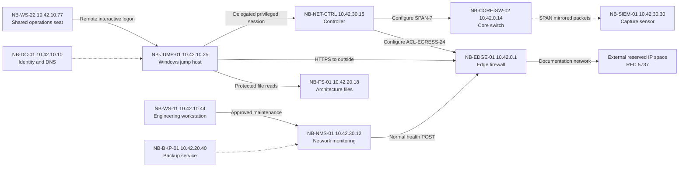

# Network architecture -- fictional Northbridge Systems

This is the required multi-host architecture map for the training case. All addresses are simulated and non-routable or documentation-only.

## Trust boundaries
- **VLAN 110:** workstations and jump access; identity required before privileged movement.
- **VLAN 120:** protected servers; read operations must meet explicit asset and principal authorization.
- **VLAN 130:** monitoring and controller; SPAN state is **not** proven by an endpoint-agent heartbeat.
- **VLAN 199:** control network and perimeter transport; policy changes require action-specific approval.
- **Outside:** reserved documentation addresses such as 203.0.113.0/24 and 198.51.100.0/24; do not contact.

The diagram documents expected connections and trust zones; it is not a proof that every drawn path was used during this incident. Validate each actual event from the exhibits. This is a topology diagram, not a traffic-capture replacement.
